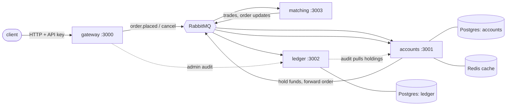

<div align="center">

# ledgerforge

An order-matching engine with a double-entry ledger, built as four small services. Orders are held, matched, settled and audited with exact integer money, and the whole thing ships with Docker Compose, Helm, Terraform, metrics, traces and a CI pipeline.


Refer to [CONTRIBUTING.md](CONTRIBUTING.md) for how to pitch in.
Refer to [LICENSE](LICENSE) for the legal bits.

</div>

## 🧭 What it does

You deposit funds, place limit orders, and the engine matches them by price then arrival time. When two orders cross, the trade settles on both accounts and lands in an append-only ledger. A separate audit replays the whole ledger and checks it against what the accounts service says each account holds. If the two ever disagree by a single unit, the audit says so.

## 🏗️ Architecture



| Service | Owns | Notes |
|---|---|---|
| gateway | The public HTTP API | API-key auth, per-key rate limit, `Idempotency-Key` on orders, input validation |
| accounts | Balances and holds | Reserves funds before an order reaches the book, settles trades, Redis balance cache |
| matching | The order books | One queue per symbol, price-time priority, GTC / IOC / FOK. Journals every message to Postgres and rebuilds the books from it on start. |
| ledger | The journal | Append-only, hash-chained, balanced per currency, enforced by Postgres triggers |

A few decisions worth knowing about:

- **Funds are held first.** A buy holds `qty × price` of the quote currency, a sell holds the base currency. The order only reaches matching once the hold succeeds, so the book never contains an order that can't pay.
- **Trades settle before holds are released.** Trades and final order updates share one queue with prefetch 1, so ordering is guaranteed by the broker rather than by luck.
- **Every consumer is safe to run twice.** Events carry ids that the database rejects on repeat. Failures retry on a delay queue and end up in a dead-letter queue after the retry limit.
- **The ledger can't be edited.** Triggers block `UPDATE`, `DELETE` and `TRUNCATE` on the journal, and a deferred trigger rejects any entry whose debits and credits don't match per currency. Each entry carries the hash of the one before it.
- **The book survives a crash.** Matching commits each input and its result to a journal before publishing anything. On start it replays the journal into empty books and checks every replayed result against what was stored; if one differs it refuses to start rather than trade on a wrong book. A message redelivered after a crash gets its stored result published again, and the consumers downstream drop repeated event ids. If the journal write itself fails, matching exits and rebuilds from the journal instead of carrying on with a book that is ahead of it.
- **Integers all the way.** The book uses safe integers, the database and ledger use `bigint`. There are no floats anywhere near money.

## 🚀 Quick start

You need Node 22.18 or newer and Docker.

```sh
npm install
docker compose up -d --build   # the whole stack
npm run e2e                    # deposits, a trade, balance checks, a clean audit
```

Then try it by hand. The compose file ships two throwaway API keys (`key-alice` for `alice`, `key-bob` for `bob`) and the admin key `admin-secret`.

```sh
curl -X POST localhost:3000/deposits -H 'x-api-key: admin-secret' -H 'content-type: application/json' \
  -d '{"account":"alice","currency":"USD","amount":"1000000"}'

curl -X POST localhost:3000/orders -H 'x-api-key: key-alice' -H 'content-type: application/json' \
  -d '{"symbol":"BTC-USD","side":"buy","price":"60000","qty":"5"}'

curl localhost:3000/balances/alice -H 'x-api-key: key-alice'
curl localhost:3000/audit -H 'x-api-key: admin-secret'
```

| URL | What |
|---|---|
| http://localhost:3000 | Gateway |
| http://localhost:3005 | Grafana (dashboard "LedgerForge", anonymous view, admin / admin to edit) |
| http://localhost:9090 | Prometheus, with alert rules loaded |
| http://localhost:16686 | Jaeger traces |
| http://localhost:15672 | RabbitMQ management (ledgerforge / ledgerforge) |

## 🔌 API

Amounts, prices and quantities are integer strings in minor units. Send the key in `x-api-key`.

| Method | Path | Who | What |
|---|---|---|---|
| POST | `/orders` | account key | Place a limit order. Returns 202 and an `orderId`. Honours `Idempotency-Key`. |
| GET | `/orders/:id` | account key | Order status, filled and remaining quantity, and the reject reason if any. Only your own orders. |
| DELETE | `/orders/:id` | account key | Cancel. Releases whatever is still held. |
| GET | `/balances/:account` | that account, or admin | `available` and `held` per currency |
| POST | `/deposits` | admin | Credit an account. A repeated `eventId` is a no-op. |
| GET | `/audit` | admin | Replay the ledger and compare it to the accounts service |
| GET | `/healthz`, `/readyz`, `/metrics` | none | On every service |

Order fields: `symbol` (for example `BTC-USD`), `side` (`buy` or `sell`), `price`, `qty`, and an optional `tif` of `GTC` (default), `IOC` or `FOK`.

## 🔭 Observability

- **Logs**: JSON via pino, one line per request, with the `x-request-id` carried across services.
- **Metrics**: Prometheus on every service. HTTP counts and latency, queue outcomes (`ok`, `retry`, `dead`, `poison`), match time, orders by status and book depth. The Grafana dashboard and the alert rules in [`deploy/observability`](deploy/observability) are provisioned automatically.
- **Traces**: OpenTelemetry over OTLP to a collector, then Jaeger. Tracing turns on when `OTEL_EXPORTER_OTLP_ENDPOINT` is set.

## ☸️ Deploying

| Path | What |
|---|---|
| [`Dockerfile`](Dockerfile) | One non-root image for all four services. Pick one with `SERVICE`. |
| [`docker-compose.yml`](docker-compose.yml) | The full local stack, with health checks |
| [`deploy/helm/ledgerforge`](deploy/helm/ledgerforge) | Chart for the four services. Postgres, Redis and RabbitMQ are yours to supply. |
| [`deploy/k8s`](deploy/k8s) | Throwaway Postgres, Redis and RabbitMQ plus matching Helm values, for kind or minikube |
| [`deploy/terraform`](deploy/terraform) | Namespace, generated API keys, a Secret and the Helm release |

On a local cluster:

```sh
kubectl apply -f deploy/k8s/dev-infra.yaml
helm install lf deploy/helm/ledgerforge -f deploy/k8s/values-dev.yaml
```

This has been run on a kind cluster, and `npm run e2e` passes against it through a port-forward. The Terraform module has also been applied to a kind cluster, and the e2e passes against that release with two accounts replicas.

The chart runs matching as a single pod with a `Recreate` strategy on purpose. See the limits below.

## 🗂️ Layout

```
packages/shared/     config, logger, metrics, tracing, db + migrations, Redis, RabbitMQ bus, HTTP app, lifecycle
services/gateway/    public API
services/accounts/   balances, holds, settlement
services/matching/   order book, engine and journal
services/ledger/     journal and audit
test/                full-flow integration test
scripts/e2e.ts       end-to-end check against the compose stack
deploy/              helm, k8s, terraform, observability, postgres init
```

## 🧪 Testing

```sh
npm run typecheck
npm test                  # 50 unit tests, no Docker needed
npm run test:integration  # 26 tests against real Postgres, RabbitMQ and Redis in containers
npm run e2e               # against a running compose stack
npm run bench             # order book micro-benchmark, no Docker
```

The full-flow test starts the four services as real processes next to real infrastructure and drives them through the gateway: auth, deposits and replays, a crossing trade, a rejected order, idempotency keys and a clean audit.

## ⏱️ Benchmark

`npm run bench` times the order book on its own: one thread, no network, no database, 1,000,000 orders per scenario. One run on a Windows 11 desktop with Node 24:

| Scenario | Orders/s | p50 | p99 |
|---|---|---|---|
| Everything rests, nothing crosses | ~1.4M | 0.5 µs | 1.3 µs |
| Crossing mix (about 0.7 trades per order) | ~2.0M | 0.3 µs | 1.0 µs |
| Resting orders with a cancel every third order | ~1.6M | 0.4 µs | 1.1 µs |

Treat these as rough. They vary from run to run and machine to machine, the per-order timings include the cost of reading the clock, and they say nothing about the whole system. End to end, throughput is set by Postgres commits and RabbitMQ round trips, and the next section measures that.

## 📈 Load test

`npm run load` pushes crossing orders through the real stack (gateway, accounts, matching, ledger, with Postgres, RabbitMQ and Redis in compose) and then checks the ledger audit. Start the stack with `RATE_LIMIT=1000000 docker compose up -d --build --wait`, then `node scripts/load.ts 2000 32`. One run, 2,000 orders and 1,000 trades with 32 in flight, on a Windows 11 desktop with Docker Desktop and everything on the one host:

| Stage | Result |
|---|---|
| Gateway accepts orders | ~2,900 orders/s (p50 9 ms, p99 54 ms) |
| Accounts settles them | ~190 orders/s (10.6 s for the run) |
| Ledger caught up | 10.7 s, 1,002 entries, zero drift |

The gateway only accepts and queues, so settlement is the real ceiling. Each queue runs at prefetch 1 so a trade is always settled before the hold it draws on is released, which means round trips to Postgres add up one after another. Numbers move from run to run and machine to machine.

## ⚠️ Honest limits

This is a portfolio project, not an exchange. Things it does not do:

- **Recovery replays the whole journal.** The book is rebuilt from every message matching has ever seen, with no snapshots or compaction, so start-up time and journal size grow with history.
- **One matching process per symbol.** Each symbol has one queue and one in-memory book, and there is no failover. While matching is down, orders queue up in RabbitMQ. Scaling out means splitting symbols across processes, not adding replicas.
- **A cancel can beat its own hold.** The cancel goes straight to matching. If it arrives before the order has been held and forwarded, it does nothing and the order goes on to rest, so the caller has to retry the cancel.
- **Limit orders only**, and the list of symbols is fixed at start-up.
- **Static API keys.** There are no users, sessions or key rotation.
- **Changing a queue's arguments needs the queue deleted first.** `accounts.fills` is a single-active-consumer queue so that replicas can't settle a trade after its hold has been released. RabbitMQ won't redeclare an existing queue with different arguments, so an older deployment has to drain and delete that queue once before upgrading.
- **Settlement is slow next to matching.** About 190 orders/s end to end on one host, held back by prefetch 1 on the fills queue. Batching would help but needs care to keep the ordering rules.
- **The ledger audit isn't exported as a metric.** It is an admin endpoint, and the alert rules watch dead-lettered messages instead.
